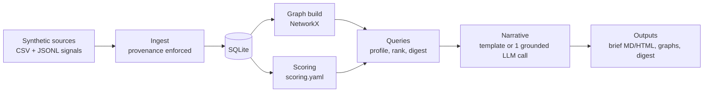
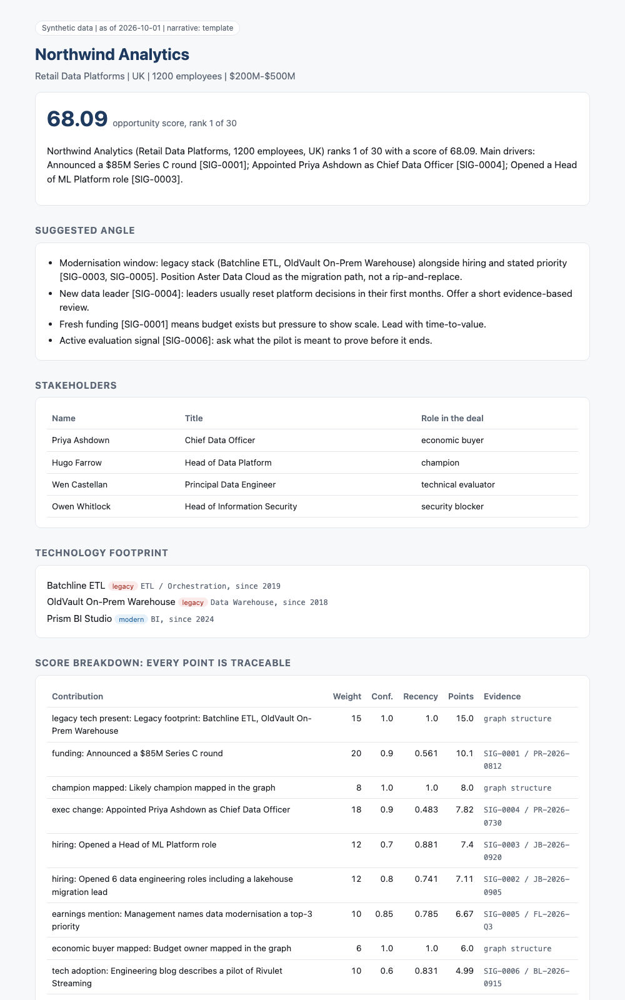
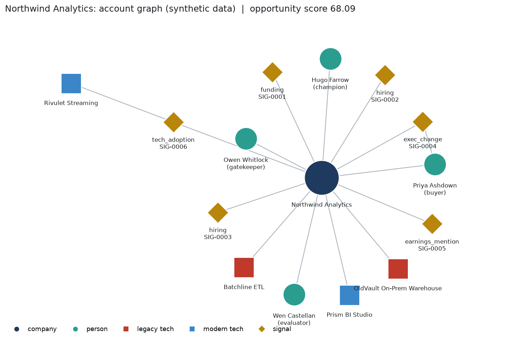

# Commercial Intelligence Graph

A small, illustrative pipeline that turns scattered market signals into an **explainable account brief**: who to talk to, why now, and which signals back it up.

> **All data is synthetic.** Every company, person, number, source ID and URL is invented (evidence links point to `example.test`). Any resemblance to real entities is coincidental. This is a showcase of approach, not a production system, and it contains no client data, personal data, credentials or proprietary scoring logic.

## Run it (about 60 seconds)

```bash
git clone <this repo> && cd commercial-intelligence-graph
python3 -m venv .venv && source .venv/bin/activate
pip install -e ".[dev]"
cig demo          # no network, no API key
pytest            # 11 tests
```

`cig demo` generates the data, ingests it, scores 30 accounts, writes a brief for one hero account, and draws the graphs into `outputs/`.

## The story: one account, end to end

**Problem.** Before a call, a seller pieces together funding news, job posts, leadership changes and tech footprint from five tabs. The result is slow, inconsistent, and nobody can say *why* an account was prioritised.

**Input data** (`data/synthetic/`): 30 companies, 77 people with deal roles, 10 technologies (legacy vs modern), 73 usage links, and 54 market signals. Every signal carries provenance: `source_type`, `source_id`, `observed_at`, `evidence_url`, `confidence`. Ingest **rejects** any signal missing one of them, so nothing unsourced can reach a score.

**Architecture.**



**Transformation.** Signals become graph edges (`company - uses - technology`, `person - works_at - company`, `signal - observed_at - company`). The score is a sum of visible contributions: `weight x confidence x recency` per signal (recency halves every 60 days), plus structural points from the graph (legacy tech present, champion mapped, security gatekeeper). Weights live in [scoring.yaml](scoring.yaml). A test asserts that the total equals the sum of its listed contributions.

**Output.** For the hero account, `Northwind Analytics`:



Excerpt of the terminal run:

```text
== 3/5 Research the hero account: Northwind Analytics
  + 15.0  legacy_tech_present        graph structure
  + 10.1  funding                    SIG-0001 / PR-2026-0812
  +  8.0  champion_mapped            graph structure
  + 7.82  exec_change                SIG-0004 / PR-2026-0730
  +  7.4  hiring                     SIG-0003 / JB-2026-0920
```



**Commercial value.** The seller knows who the buyer, champion, evaluator and gatekeeper are, which timing signal justifies the call, what to ask first, and can defend the prioritisation to a manager because every point cites a source.

## What is deterministic, what uses an LLM, what is agentic

| Layer | Status | Notes |
|---|---|---|
| Data generation, ingest, graph, scoring, ranking, digest | **Deterministic workflow** | Same seed and weights give byte-identical results |
| Brief narrative, default | **Deterministic template** | Rules over scored facts, no model |
| Brief narrative, `--llm` | **LLM-assisted synthesis (optional)** | One grounded call (needs `ANTHROPIC_API_KEY`, `pip install ".[llm]"`). Output is validated: any invented signal ID triggers a fallback to the template |
| Autonomous research loop with tools and self-checking | **Not built** | Listed under Planned. Nothing here should be read as an "agent" |

## Technical capabilities and what they enable commercially

| Capability shown | Commercial application |
|---|---|
| Data modelling and ingestion with validation | One trusted account view for territory planning |
| Graph relationships (people, tech, signals) | Stakeholder and champion mapping before the first call |
| Provenance on every signal | Evidence you can show a buyer or a sales manager |
| Explainable, configurable scoring | Prioritisation and pipeline conversations you can defend and tune |
| Grounded LLM synthesis with output validation | Pre-call prep in minutes without hallucinated facts |
| Offline-first, seeded, tested | Safe to demo anywhere, results reproducible |

## Other use cases

- **Market mapping:** `cig map --segment "Retail Data Platforms"` ([example](outputs/map_retail_data_platforms.png))
- **Opportunity identification:** `cig opportunities --top 10` ranked list with top contributions ([example](outputs/opportunities.txt))
- **Automated intelligence brief:** `cig digest` weekly top movers ([example](outputs/digest.md))
- **Single account:** `cig brief "Northwind Analytics" [--llm]`

## Working vs planned

| Working in this repo | Planned (not built) |
|---|---|
| Seeded synthetic generator, SQLite ingest with provenance checks | Live public-API connectors |
| Knowledge graph, 4 use cases, explainable scoring | Scheduled runs and alert delivery |
| MD and HTML briefs, graph images, digest | CRM export |
| Optional single LLM call with citation validation | Multi-step research agent with tool use and self-checks |
| 11 tests, offline CLI | Graph database backend, cross-source entity resolution |

## Layout

```
src/cig/       generate, ingest, graph, scoring, queries, synthesis, cli
scoring.yaml   all weights, one file
data/synthetic seeded sample data (committed)
outputs/       sample brief, graphs, digest
tests/         determinism, provenance, score traceability, citation validation, offline CLI
docs/          architecture notes
```

Stack: Python, SQLite, NetworkX, Matplotlib, Jinja2. The seller product in the examples ("Aster Data Cloud") is fictional.
